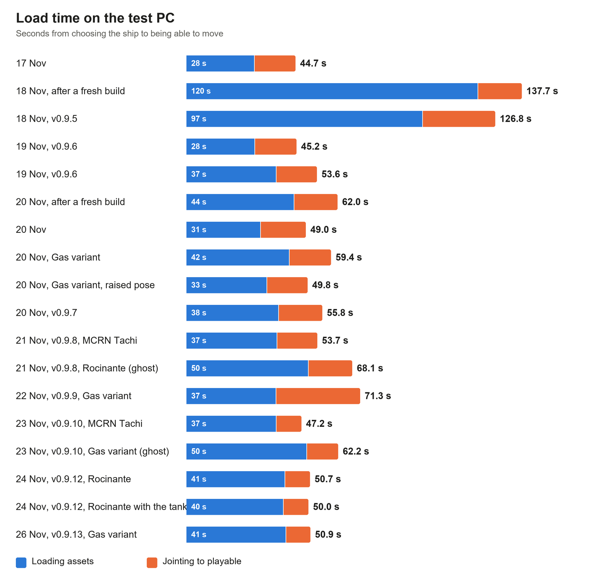
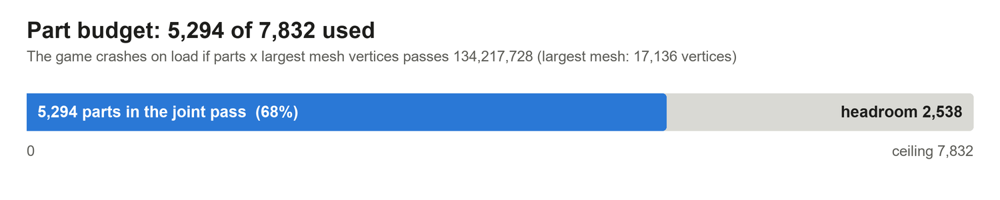

# Tachi: Ship Statistics

A custom salvage ship for Hardspace: Shipbreaker, modelled on the MCRN Corvette-class light frigate *Tachi* from *The Expanse*.

Version 0.9.8, 21 November 2026. Figures marked v0.9.8 are from loads of that build on 21 November: the MCRN Tachi as a normal ship and the Rocinante as a ghost ship. The Gas Hauler was not loaded on this build, and the category, section, loose-part and cut-point tables were not re-measured; those are still from the v0.9.7 builds of 20 November 2026. Base ship ("MCRN Tachi") part figures are from the build of 20 November, 21:52 (the release build); Gas variant ("Beratnas Gas Hauler") part figures are from the load of 20 November, 19:59, and are marked where the two differ in date. "Measured" means taken from the game or the editor on that build. "Estimate" means calculated, with the method given.

## At a glance

| | |
|---|---|
| Length (engine bell to antenna tip) | 133.7 m |
| Beam (port to starboard, over the gun mounts) | 54.6 m (Gas variant, over the tank racks: 67.2 m) |
| Height (dorsal to ventral) | 46.3 m (Gas variant: 55.1 m) |
| Parts counted at load | 5,210 (MCRN Tachi, v0.9.8) · 5,104 (Rocinante, v0.9.8) · 5,866 (Gas variant, v0.9.7) |
| As a ghost ship | 59 Protomolecule nodes and 251 growth patches more (see Ghost ship content) |
| Cut points | 254 (Gas variant: 333) |
| Loose items at spawn | 181 (props, pickups and one floating corpse, in one of six places) |
| Estimated mass | at least 268 t (Gas variant: about 394 t; see Mass) |
| Download size | 203 MB (zip, all three variants) |
| Load time on the test PC | 45 to 138 s |

---

## 1. Loading and technical

### Load time

Measured on the test PC, from choosing the ship to being able to move:

| Run | Total | Loading assets | Jointing to playable |
|---|---|---|---|
| 17 Nov | 44.7 s | 28.0 s | 16.7 s |
| 18 Nov, after a fresh build | 137.7 s | 119.8 s | 17.9 s |
| 18 Nov, v0.9.5 | 126.8 s | 97.1 s | 29.7 s |
| 19 Nov, v0.9.6 | 45.2 s | 28.2 s | 17.0 s |
| 19 Nov, v0.9.6 | 53.6 s | 37.0 s | 16.6 s |
| 20 Nov, after a fresh build | 61.9 s | 44.3 s | 17.7 s |
| 20 Nov | 49.0 s | 30.6 s | 18.4 s |
| 20 Nov, Gas variant | 59.3 s | 42.4 s | 17.0 s |
| 20 Nov, Gas variant, raised pose | 49.8 s | 33.2 s | 16.6 s |
| 20 Nov, v0.9.7 | 55.7 s | 38.0 s | 17.8 s |
| 21 Nov, v0.9.8, MCRN Tachi | 53.8 s | 37.3 s | 16.4 s |
| 21 Nov, v0.9.8, Rocinante as a ghost ship | 68.1 s | 50.2 s | 17.9 s |

The v0.9.5 run had the mod's part-data capture switched on, which adds load time, so it overstates a normal load.

Test PC: AMD Ryzen 7 5800X (8 cores), 64 GB RAM, NVMe SSD, RTX 4070 Ti.

The last stage takes about 15 to 30 s. The asset-loading stage varied more than threefold between runs on the same machine, so expect a wide spread; the two longest runs each followed a fresh build of the ship.

**Expected load time on other hardware.** These are estimates scaled from the shortest and longest runs above, not measurements. No other machine has been timed.

| PC | CPU class | RAM | Storage | Expected load |
|---|---|---|---|---|
| High end | Ryzen 7 5800X, Core i7-11700K or newer | 32 GB or more | NVMe SSD | 45 s to 2.5 min (measured on 64 GB) |
| Mid range | Ryzen 5 3600, Core i5-10400 | 16 GB | SATA SSD | 1 to 3.5 min |
| Older | Ryzen 5 2600, Core i5-8400 | 16 GB | Hard disk | 2 to 6 min |
| Minimum | any | 8 GB | any | untested; may fail to load |

If the game sits on the loading screen for more than ten minutes, treat it as a failed load.

### Parts

| | |
|---|---|
| Live parts at spawn (every piece the game simulates) | 5,211 (v0.9.7 census) |
| Parts counted by the game's joint pass | 5,210 (v0.9.8; 5,208 on v0.9.7) |
| Objects in the ship that never become parts | 276 (see below) |
| Largest mesh | `PDC_Mid_Port_Nest_02`, 18,291 vertices |
| Part ceiling at that mesh size | 7,337 |
| Headroom | 2,127 parts |

**The part ceiling.** While the ship loads, the game multiplies the number of parts by the vertex count of the largest single mesh. If that product passes 134,217,728 the game crashes on load. With the current largest mesh that allows 7,337 parts. Adding parts, or adding one mesh larger than 18,291 vertices, both use up the headroom.

**Objects that never become parts.** 277 objects in the ship are switched off by the game's own prefabs and are not simulated:

| Object | Count |
|---|---|
| Ladder rungs | 248 |
| Door frame caps | 6 |
| Room cage bars | 4 |
| Other (airlock coupler joints, railings, spare suit meshes, one pickup) | 19 |

### Parts by category

| Category | Parts | Share |
|---|---|---|
| Furniture and props | 1,713 | 32.9 % |
| Decks, walls, stairs and doors | 1,013 | 19.4 % |
| Pipes and cables | 825 | 15.8 % |
| Machinery, power and weapons | 749 | 14.4 % |
| Cut points | 254 | 4.9 % |
| Lights | 246 | 4.7 % |
| Hull panels | 207 | 4.0 % |
| Structural frame | 204 | 3.9 % |

The category and section tables are from the same census as the totals. Four pipe pieces at the fore thermal vents carry the cut point type so that they do not joint to the vents; they are counted here as pipe.

Categories are assigned from each part's joint type and name. The rules were rewritten for v0.9.5, so these shares are not comparable with earlier versions of this document.

### Parts by section

| Section | Parts | Largest categories |
|---|---|---|
| Interior | 4,207 | Furniture and props 38 %, decks and walls 21 %, pipes and cables 17 % |
| Aft interior | 476 | Pipes and cables 23 %, decks and walls 22 %, machinery 22 % |
| Forward hull | 271 | Hull panels 56 %, machinery 28 %, structural frame 7 % |
| Aft hull and engine | 257 | Structural frame 34 %, machinery 23 %, hull panels 22 % |

### Loose parts

Every structural part of the ship is attached. At spawn the main structure is one body of 5,030 parts, and nothing structural is separate from it.

| | |
|---|---|
| Main structure | 5,030 parts in one body |
| Loose parts | 181, in 156 separate bodies |
| Loose single items | 146 |
| Loose bodies of more than one part | 10 |

All 181 loose parts are items meant to float or be picked up:

| Type | Parts | Share |
|---|---|---|
| Galley items (bowls, food, coffee maker, vending parts) | 38 | 21.0 % |
| Bottles | 32 | 17.7 % |
| Data and credit drives | 28 | 15.5 % |
| Snack packs | 19 | 10.5 % |
| Suit pieces and helmets | 18 | 9.9 % |
| Other (ten spare-part pickups, wall chestplates, a repair kit, a toy, two salvage bay objects) | 17 | 9.4 % |
| Floating corpse and its suit | 15 | 8.3 % |
| Supply pickups (oxygen, thruster fuel, med and patch kits) | 7 | 3.9 % |
| Crates and pouches | 5 | 2.8 % |
| Desk items | 2 | 1.1 % |

The loose bodies of more than one part:

| Body | Parts |
|---|---|
| Floating corpse | 13 |
| Bowl, spoon and food set | 5 |
| Coffee maker, pot and vending part | 3 |
| Seven pairs of small items | 2 each |

### Pipes, cut points and hull colliders

Every hull part collides as the convex shape wrapped round it, not as its visible mesh. On the folded hull panels of the engineering section that left invisible collider faces across the pockets where the fuel and coolant pipes run, and put pipe cut points out of reach. The 20 November rework changed three things:

| | |
|---|---|
| Hull parts given inside plates | 12 (11 engineering wall panels and the sealed hatch; the two mid thermal vents were returned to their original shape, see below) |
| Plate area added | 50 to 210 m² per part; each part's outline and collider are unchanged |
| Pipe cut points at spawn | 91, every one jointed and none fully inside a collider |
| Inline cut points on the coolant ring | 12 |
| Pipe pieces loose at spawn | 0 |

- **Inside plates.** Each of the 14 parts is closed along its own collider on every face except those on the outside of the ship, so what blocks the player is now visible.
- **Cut points.** Each fuel and coolant line keeps its start on the interior wall. Its cut point sits on the last stretch of pipe that is clear of the part's collider, as close to the part as it fits, and one short piece of pipe runs on into the part.
- **Coolant ring.** The ring runs straight through the hull panels, with inline cut points on each open stretch. The stretch under the ventral panel has no open pipe and no cut point of its own.

Four cut points still reach a few centimetres into a collider (up to 13 cm) where there was less than 25 cm of open pipe.

**Thermal vents.** The four thermal vents are built from a material that accepts fuel, and glowed white in game wherever a fuel pipe, junction box or the game's pipe cut point jointed to them. The cut points beside all four vents are now baked cut points of the plain chassis type, and each fore riser ends in a bend and a pipe of the same type running into its vent. Those pieces look like fuel pipe but carry nothing and do not joint to the vents.

### Ghost ship content

When any of the three ships is taken as a ghost ship it carries the following. None of it is on a normal ship.

| | |
|---|---|
| Protomolecule nodes | 59: 2 to 5 on every deck, 8 on the two crawlspace generators, 7 on the reactor, 5 on the cryogenics coolant tanks |
| Node types | 3 crystal shapes (cluster, spire, ridge), picked at random per spot |
| Growth patches | 251: 110 on the hull, 138 on deck walls, floors and ceilings, 3 in Engineering |
| Growth patterns | 4 (colony, streak, ring, lobes) in 4 sizes, 3 to 10 m across |
| Growth on the corpse | 1 patch across its front |

The nodes are the ship's AI nodes: the haunting weakens as they are destroyed and stops when none are left. They scan as "Protomolecule". Sixteen of them sit on a growth patch.

| Area | Growth patches | Nodes |
|---|---|---|
| Hull | 110 | |
| Flight deck | 10 | 2 |
| Command deck | 12 | 3 |
| Deck 9 | 14 | 4 |
| Deck 8 | 12 | 3 |
| Deck 7 | 12 | 3 |
| Deck 6 | 12 | 4 |
| Deck 5 | 11 | 3 |
| Deck 4 | 12 | 3 |
| Deck 3 | 12 | 2 |
| Deck 2 | 5 | 4 |
| Deck 1 | 12 | 3 |
| Deck 0 | 14 | 5 |
| Engineering, reactor and cryogenics | 3 | 20 |

Growth is painted onto the parts when the ship spawns and stays on each part after cutting. It adds no parts. The nodes add 59 parts. Growth is thin on Deck 2 and in Engineering because few surfaces there can take it.

### Variants

The ship comes in three versions, each listed as its own ship in Free Play and on the Career job board, with its own name and picture: MCRN Tachi, Rocinante and Beratnas Gas Hauler. The second and third are prefab variants of the first: the same ship with its own hull textures and, for the Gas Hauler, its own parts and bay pose. All three are in one bundle and share meshes and unchanged textures. All three are in the v0.9.7 release; the game picks one each time the ship is offered, by the weights below.

| | MCRN Tachi (base) | Rocinante | Beratnas Gas Hauler |
|---|---|---|---|
| What differs | | Colours as an independent warship, Belter posters, less furniture | Colours, 24 external tanks on trusses, point defence cannons removed, own bay pose, Belter posters, less furniture |
| How it is picked | Own ship entry | Own ship entry | Own ship entry |
| Live parts at spawn | 5,211 | the base less 20 switched-off objects (not measured) | 5,868 (measured before 20 objects were switched off) |
| Parts counted by the joint pass | 5,210 (v0.9.8) | 5,104 as a normal ship, 5,163 as a ghost ship (v0.9.8) | 5,866 (v0.9.7, not re-measured) |
| Headroom under the part ceiling | 2,127 | 2,233 (2,174 as a ghost ship) | 1,471 |
| Main structure | 5,030 | | 5,684 |
| Loose parts | 181 in 156 bodies | | 184 in 159 bodies |
| Cut points | 254 | | 333 |
| Size (length x beam x height) | 133.7 x 54.6 x 46.3 m | same | 133.7 x 67.2 x 55.1 m |
| Estimated mass | at least 268 t | same | about 394 t (see Mass) |
| Wall posters at 30 spots | MCRN | Belter | Belter |
| Crew bunks (berths) | 28 | 12 | 12 |
| Medbay beds | 5 | 5 | 5 |
| Galley tables | centre, long and 3 corner tables | centre and long table | centre and long table |
| Deck carpets | red on the command and weapons decks, blue in the medbay and crew decks, green in the galley, grey on the airlock deck | same | same |
| Floating corpse | one, in one of 6 places, as one of 7 factions, each with its own suit colours and visor | same | same |
| As a ghost ship | 59 Protomolecule nodes, 251 growth patches | same | same |

Base figures are from the build of 20 November, 21:52 (the release build). Gas figures are from the load of 20 November, 19:59, before the last interior changes of that evening (four flight deck seats replaced by server towers, a galley table and two chairs removed), which take about 60 parts off every variant.

**Interior differences.** The three ships share one interior, with these differences:

- **Posters.** Thirty wall posters are MCRN posters in the MCRN Tachi (MCRN Colors, MCRN Logo, MCRN Corvette, Mars Needs You) and Belter posters in the other two (OPA, three Remember the Cant designs, Beltalowda, Tycho, Ceres Water). The poster objects are the same; only the picture differs.
- **Bunks.** The six crew cabins on Decks 3 and 4 hold 14 two-tier bunks in the MCRN Tachi (28 berths) and one two-tier bunk each in the other two (6 bunks, 12 berths). The 5 medbay beds are in all three and are not counted as crew bunks.
- **Galley.** The other two ships have no corner tables: three tables, six chairs and the three bottles on them are switched off. The centre table and the long table are in all three.

Switched-off objects are still in the download, so the size is the same. These differences were checked in the editor, not yet in game, and the part counts above were measured before them.

**Gas variant tank racks**

| | |
|---|---|
| Tanks | 24: 16 large and 8 small |
| Truss parts | 78 (24 beams, 35 feet, 19 links), aluminium structure |
| Hull cut points holding the racks | 35 |
| Tank cradle cut points | 48 |
| Joints between truss and hull other than through cut points | 0 |
| Large tank body mass | 7,500 kg (28,689 kg before hollowing) |
| Small tank body mass | 5,500 kg (7,879 kg before hollowing) |

The racks are held to the ship only by cut points: in the census every foot joints to its beam and to a cut point, and every hull cut point joints to a hull part.

The tank masses are calculated with the game's own formula (material density times the signed volume of the part's mesh) and reproduce the figures the game reported before the change. Each tank body has an inward-facing inner shell that subtracts volume, so the outside size is unchanged. The new masses have not yet been read back in game.

**Gas variant bay pose.** The Gas variant is too wide to sit between the light jacks, so it spawns level, nose toward the Master Jack, raised above them: the ship's axis is 49.5 m above the bay's centre line. The engine bell and reactor housing are 5 m above the tallest light jack. One tank hangs below that level and clears the nearest light jack by 7.5 m. No mod is needed to make room for it.

Earlier versions of this document listed the engine nozzle, the reactor and a coolant pipe network as separate bodies. That was a counting error in the analysis, not a fault in the ship; the census now records exact joints.

---

## 2. In-game statistics

### Dimensions

| | |
|---|---|
| Length | 133.7 m |
| Beam | 54.6 m |
| Height | 46.3 m |
| Decks | 12 (Deck 0 to Deck 9, Command, Flight) |
| Hull envelope volume (estimate) | about 68,000 m³ |

The volume is an upper estimate: the outline of the hull parts was taken every metre along the ship and the slices added up. It counts the space inside the hull's outline, not the solid material, and it excludes the gun mounts and thrusters.

### Mass

Estimated total: **at least 268 t**.

The game works out a part's mass from its material density and the volume of its mesh. This figure adds that up for every custom mesh, and uses the mass the game reported for each stock part. It covers 2,592 of 3,461 objects (75 %). The rest could not be resolved, and stock assemblies made of several pieces are counted by their main piece only, so the true figure is higher.

**Gas variant mass.** About 394 t, an estimate built on the base figure: 268 t, less up to 38 t for the point defence cannon parts the variant removes, plus 164 t for the 24 tank bodies (16 at 7,500 kg and 8 at 5,500 kg). The trusses, tank end caps and cradle cut points are not included, so the true figure is somewhat higher.

### Cut points and joint groups

| | |
|---|---|
| Cut points | 254 |
| Forced joint groups (MJC) | 94 (counted on an earlier build) |
| Reactor mount | 4 slanted beams, each tied to a reactor panel and the cryo room floor by a cut point |
| Forward hull groups | 8, each under 20 t, tied by 11 internal cut points |
| Forward section to Engineering | 4 internal cut points |
| Torpedo salvage value | 1,218,750 credits each, 12 aboard (flat value from the blueprint) |

### By section

| Section | What it is | Live parts | Size, length × beam × height (m) | Est. mass (t) | Cut points |
|---|---|---|---|---|---|
| A_Section | Forward outer hull, gun mounts, torpedo tubes, RCS | 271 | 81.1 × 54.6 × 31.3 | 113.0 | 15 |
| Interior Vessel | Decks, tunnel walls, crawlspace, furnishings | 4,207 | 90.9 × 26.2 × 28.0 | 49.1 | 193 |
| B_External | Engineering hull, support ring, engine | 257 | 54.4 × 28.0 × 46.3 | 70.9 | 32 |
| B_Internal | Aft airlock, cryogenics, fusion reactor | 476 | 28.8 × 23.1 × 21.0 | 34.6 | 14 |

Sizes and masses were measured on an earlier 18 November build and not re-measured since; the changes since then (a reactor mount of 12 parts, two roof generators, spare-part pickups, the inside plates) do not move them noticeably. The live-part column is from the v0.9.6 census. Section masses carry the same caveat as the total. The interior figure is the least complete, because it is mostly stock assemblies.

---

## 3. The ship in *The Expanse*

### What is modelled on this ship

| | |
|---|---|
| Point defence cannons | 6: fore port, fore starboard, mid port, mid starboard, aft dorsal, aft ventral |
| Torpedo tubes | 2 (dorsal and ventral) |
| Torpedoes aboard | 12: five per tube plus two on ceiling racks |
| Crew bunks | 28 berths in 14 two-tier bunks (12 in 6 bunks in the Rocinante and the Gas Hauler) |
| Medbay beds | 5 |
| Acceleration couches | 32 |
| Main drive | 1, with a 16-segment nozzle and 8 fuel injectors |
| Reactor | 1 fusion reactor |
| RCS thruster housings | 7 |
| Heat exchangers and radiators | 8 of each |
| Airlocks | 2 (forward and aft) |
| Layout | Tower: decks stacked along the thrust axis, engine at the bottom |

**Scale.** The show's ship is usually quoted at 46 m long. This model is 133.7 m, about 2.9 times that, sized so the decks are walkable in Shipbreaker.

### Corvette-class light frigate, as described in the lore

Sourcing note: the Expanse Wiki could not be read directly when this was compiled. These figures come from a lore site that reproduces the wiki's text and from search summaries, so they are second-hand. They do not separate the TV series from the books. Items marked "unconfirmed" rest on a single secondary mention.

**Class and role**

| | |
|---|---|
| Class | Corvette-class light frigate |
| Operator | Martian Congressional Republic Navy (MCRN) |
| Roles | Fast attack, missile defence, law enforcement, reconnaissance, border patrol |
| Carried by | Donnager-class battleships; the *Tachi* sat in the hangar of the MCRN *Donnager* |
| Standing | Second-smallest MCRN warship |
| Length | 46 m (unconfirmed) |
| Beam, height, mass | not stated |

**Crew**

| | |
|---|---|
| Berths | 30 officers and crew |
| Typical complement | "well over a dozen" naval personnel, plus at least six marines on many missions |
| Minimum crew | not stated |

**Armament as built (*Tachi*)**

| | |
|---|---|
| Point defence | 6 × Nariman Dynamics 40 mm point defence cannons |
| Torpedoes | 2 launchers, 10 torpedoes each (20 total) |
| Drones | 4 reconnaissance drones |

Added later, as the *Rocinante*: a light keel-mounted railgun. One summary gives it 1 kg tungsten rounds at about 9,980 m/s (unconfirmed).

**Propulsion**

| | |
|---|---|
| Main drive | Single Epstein drive; reactor and drive cone at the base of the ship |
| Class acceleration, g limits | not stated |

The lore gives performance figures for the Epstein drive in general, not for this class:

| Epstein drive, general figures | |
|---|---|
| Fusion fuel | Deuterium and helium-3, 1:2 |
| Thrust | 6,370,000 N |
| Specific impulse | 1,927,000 s |
| Exhaust velocity | 18,900,000 m/s (6.8 % of light speed) |
| Mass flow | 2.2 kg/s |
| Thrust power | 60.2 TW |
| Total output | 96.8 TW |

**Decks, bottom to top:** storage and engineering, machine shop, galley and crew cabins, medical bay, storage, crew airlock, command deck, flight deck.

---

## How the figures were obtained

| Figure | Source |
|---|---|
| Load times, joint-pass part count, largest mesh, part ceiling | Logged by the PartInfoLogger mod during loading |
| Live parts, categories, loose parts, cut points per section | The mod's spawn census: base ship from the build of 20 November, 21:52 (the release build), Gas variant from the load of 20 November, 19:59; exact joints between parts |
| Dimensions, per-section sizes | Part bounds in the Unity editor |
| Volume | Calculated from part bounds, as described above |
| Mass | Calculated with the game's own formula from mesh volume and material density, plus game-reported masses for stock parts |
| v0.9.8 part counts and load times | Logged by the PartInfoLogger mod on loads of 21 November: MCRN Tachi as a normal ship, Rocinante as a ghost ship. The Rocinante normal-ship count is the ghost count less its 59 nodes |
| Ghost ship content | Counted from the spawn points in the ship prefab |
| Lore | Second-hand, as noted in section 3 |
