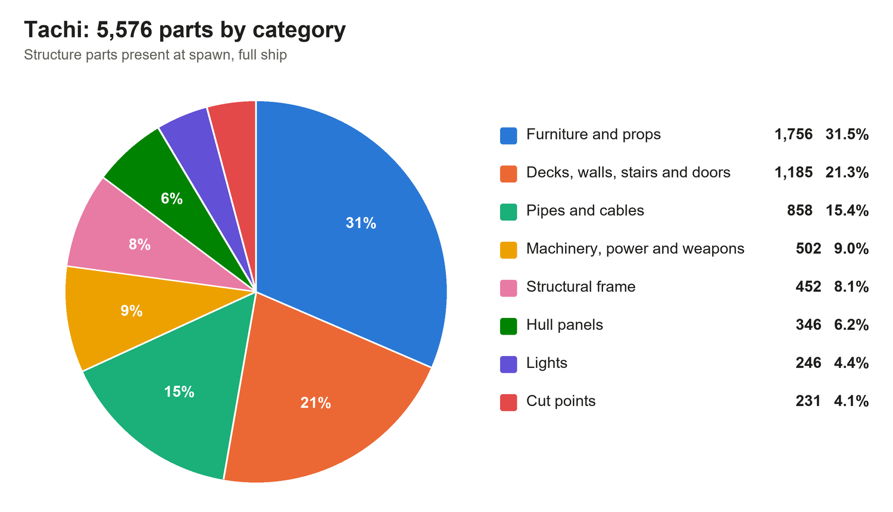

# Tachi: Ship Statistics

A custom salvage ship for Hardspace: Shipbreaker, modelled on the MCRN Corvette-class light frigate *Tachi* from *The Expanse*.

Figures are from the build of 18 November 2026. "Measured" means taken from the game or the editor on that build. "Estimate" means calculated, with the method given.

## At a glance

| | |
|---|---|
| Length (engine bell to antenna tip) | 133.7 m |
| Beam (port to starboard, over the gun mounts) | 54.6 m |
| Height (dorsal to ventral) | 46.3 m |
| Parts at spawn | 5,576 |
| Cut points | 231 |
| Estimated mass | at least 268 t (see Mass) |
| Download size | 177 MB (zip) |
| Load time on the test PC | 45 to 138 s |

---

## 1. Loading and technical

### Load time

Measured on the test PC, from choosing the ship to being able to move:

| Run | Total | Loading assets | Jointing to playable |
|---|---|---|---|
| 17 Nov, full ship | 44.7 s | 28.0 s | 16.7 s |
| 18 Nov, full ship | 137.7 s | 119.8 s | 17.9 s |

Test PC: AMD Ryzen 7 5800X (8 cores), 64 GB RAM, NVMe SSD, RTX 4070 Ti.

The last stage is steady at about 15 to 20 s. The asset-loading stage varied threefold between two runs on the same machine, so expect a wide spread; the longer run followed a fresh build of the ship.

**Expected load time on other hardware.** These are estimates scaled from the two runs above, not measurements. No other machine has been timed.

| PC | CPU class | RAM | Storage | Expected load |
|---|---|---|---|---|
| High end | Ryzen 7 5800X, Core i7-11700K or newer | 32 GB or more | NVMe SSD | 45 s to 2.5 min (measured on 64 GB) |
| Mid range | Ryzen 5 3600, Core i5-10400 | 16 GB | SATA SSD | 1 to 3.5 min |
| Older | Ryzen 5 2600, Core i5-8400 | 16 GB | Hard disk | 2 to 6 min |
| Minimum | any | 8 GB | any | untested; may fail to load |

If the game sits on the loading screen for more than ten minutes, treat it as a failed load.

### Parts

| | |
|---|---|
| Parts at spawn (every piece the game tracks) | 5,576 |
| Parts counted by the game's joint pass | 5,294 |
| Largest mesh | `PDC_Mid_Port_Nest_02`, 18,291 vertices |
| Part ceiling at that mesh size | 7,337 |
| Headroom | 2,043 parts |

**The part ceiling.** While the ship loads, the game multiplies the number of parts by the vertex count of the largest single mesh. If that product passes 134,217,728 the game crashes on load. With the current largest mesh that allows 7,337 parts. Adding parts, or adding one mesh larger than 18,291 vertices, both use up the headroom.

### Parts by category

| Category | Parts | Share |
|---|---|---|
| Furniture and props | 1,756 | 31.5 % |
| Decks, walls, stairs and doors | 1,185 | 21.3 % |
| Pipes and cables | 858 | 15.4 % |
| Machinery, power and weapons | 502 | 9.0 % |
| Structural frame | 452 | 8.1 % |
| Hull panels | 346 | 6.2 % |
| Lights | 246 | 4.4 % |
| Cut points | 231 | 4.1 % |

Categories are assigned from each part's joint type and name.

### Free-floating parts

| | |
|---|---|
| Parts with no joint to anything at spawn | 424 |
| Parts not connected to the main structure | 823, in 546 separate bodies |
| Main structure | 4,753 parts in one body |

Most of the 424 are meant to be loose or are not real objects to the game:

- 248 ladder rungs, which the game does not treat as separate objects.
- Loose items: bottles, snack packs, data drives, crates, cups, suit pieces.

The larger separate bodies are:

| Body | Parts |
|---|---|
| Engine nozzle with the fuel injection system | 144 |
| Crawlspace coolant pipe network | 46 |
| Fusion reactor core | 21 |
| Floating corpse | 13 |
| 17 short pipe runs | 3 or 4 each |

---

## 2. In-game statistics

### Dimensions

| | |
|---|---|
| Length | 133.7 m |
| Beam | 54.6 m |
| Height | 46.3 m |
| Decks | 12 (Deck 0 to Deck 9, Command, Flight) |
| Hull envelope volume (estimate) | about 68,000 m³ |

The volume is an upper estimate: the outline of the hull parts was taken every metre along the ship and the slices added up. It counts the space inside the hull's outline, not the solid material, and it excludes the gun mounts and thrusters.

### Mass

Estimated total: **at least 268 t**.

The game works out a part's mass from its material density and the volume of its mesh. This figure adds that up for every custom mesh, and uses the mass the game reported for each stock part. It covers 2,592 of 3,461 objects (75 %). The rest could not be resolved, and stock assemblies made of several pieces are counted by their main piece only, so the true figure is higher.

### Cut points and joint groups

| | |
|---|---|
| Cut points | 231 |
| Forced joint groups (MJC) | 94 |
| Forward hull groups | 8, each under 20 t, tied by 11 internal cut points |
| Forward section to Engineering | 4 internal cut points |

### By section

| Section | What it is | Parts at spawn | Size, length × beam × height (m) | Est. mass (t) | Cut points |
|---|---|---|---|---|---|
| A_Section | Forward outer hull, gun mounts, torpedo tubes, RCS | 272 | 81.1 × 54.6 × 31.3 | 113.0 | 15 |
| Interior Vessel | Decks, tunnel walls, crawlspace, furnishings | 4,448 | 90.9 × 26.2 × 28.0 | 49.1 | 177 |
| B_External | Engineering hull, support ring, engine | 260 | 54.4 × 28.0 × 46.3 | 70.9 | 32 |
| B_Internal | Aft airlock, cryogenics, fusion reactor | 596 | 28.8 × 23.1 × 21.0 | 34.6 | 7 |

Section masses carry the same caveat as the total. The interior figure is the least complete, because it is mostly stock assemblies.

---

## 3. The ship in *The Expanse*

### What is modelled on this ship

| | |
|---|---|
| Point defence cannons | 6: fore port, fore starboard, mid port, mid starboard, aft dorsal, aft ventral |
| Torpedo tubes | 2 (dorsal and ventral) |
| Torpedoes aboard | 12: five per tube plus two on ceiling racks |
| Crew bunks | 33 |
| Acceleration couches | 36 |
| Main drive | 1, with a 16-segment nozzle and 8 fuel injectors |
| Reactor | 1 fusion reactor |
| RCS thruster housings | 7 |
| Heat exchangers and radiators | 8 of each |
| Airlocks | 2 (forward and aft) |
| Layout | Tower: decks stacked along the thrust axis, engine at the bottom |

**Scale.** The show's ship is usually quoted at 46 m long. This model is 133.7 m, about 2.9 times that, sized so the decks are walkable in Shipbreaker.

### Corvette-class light frigate, as described in the lore

Sourcing note: the Expanse Wiki could not be read directly when this was compiled. These figures come from a lore site that reproduces the wiki's text and from search summaries, so they are second-hand. They do not separate the TV series from the books. Items marked "unconfirmed" rest on a single secondary mention.

**Class and role**

| | |
|---|---|
| Class | Corvette-class light frigate |
| Operator | Martian Congressional Republic Navy (MCRN) |
| Roles | Fast attack, missile defence, law enforcement, reconnaissance, border patrol |
| Carried by | Donnager-class battleships; the *Tachi* sat in the hangar of the MCRN *Donnager* |
| Standing | Second-smallest MCRN warship |
| Length | 46 m (unconfirmed) |
| Beam, height, mass | not stated |

**Crew**

| | |
|---|---|
| Berths | 30 officers and crew |
| Typical complement | "well over a dozen" naval personnel, plus at least six marines on many missions |
| Minimum crew | not stated |

**Armament as built (*Tachi*)**

| | |
|---|---|
| Point defence | 6 × Nariman Dynamics 40 mm point defence cannons |
| Torpedoes | 2 launchers, 10 torpedoes each (20 total) |
| Drones | 4 reconnaissance drones |

Added later, as the *Rocinante*: a light keel-mounted railgun. One summary gives it 1 kg tungsten rounds at about 9,980 m/s (unconfirmed).

**Propulsion**

| | |
|---|---|
| Main drive | Single Epstein drive; reactor and drive cone at the base of the ship |
| Class acceleration, g limits | not stated |

The lore gives performance figures for the Epstein drive in general, not for this class:

| Epstein drive, general figures | |
|---|---|
| Fusion fuel | Deuterium and helium-3, 1:2 |
| Thrust | 6,370,000 N |
| Specific impulse | 1,927,000 s |
| Exhaust velocity | 18,900,000 m/s (6.8 % of light speed) |
| Mass flow | 2.2 kg/s |
| Thrust power | 60.2 TW |
| Total output | 96.8 TW |

**Decks, bottom to top:** storage and engineering, machine shop, galley and crew cabins, medical bay, storage, crew airlock, command deck, flight deck.

---

## How the figures were obtained

| Figure | Source |
|---|---|
| Load times, joint-pass part count, largest mesh, part ceiling | Logged by the PartInfoLogger mod during loading |
| Parts at spawn, categories, free-floating parts, cut points per section | The mod's spawn census from the full-ship run of 18 Nov 2026 |
| Dimensions, per-section sizes | Part bounds in the Unity editor |
| Volume | Calculated from part bounds, as described above |
| Mass | Calculated with the game's own formula from mesh volume and material density, plus game-reported masses for stock parts |
| Lore | Second-hand, as noted in section 3 |
