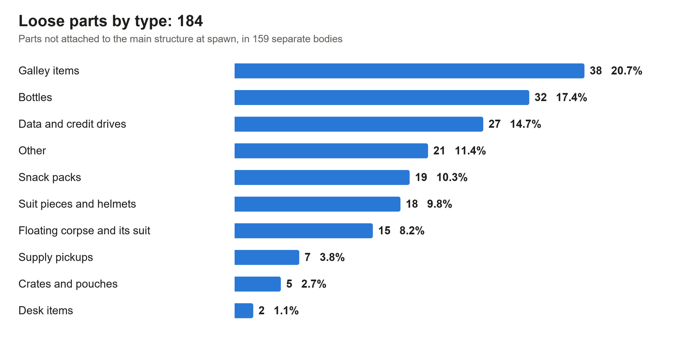

# Tachi: Ship Statistics

A custom salvage ship for Hardspace: Shipbreaker, modelled on the MCRN Corvette-class light frigate *Tachi* from *The Expanse*.

Figures are from the builds of 20 November 2026, which are newer than the v0.9.6 release. Where a table still shows v0.9.6 figures it says so. "Measured" means taken from the game or the editor on that build. "Estimate" means calculated, with the method given.

## At a glance

| | |
|---|---|
| Length (engine bell to antenna tip) | 133.7 m |
| Beam (port to starboard, over the gun mounts) | 54.6 m |
| Height (dorsal to ventral) | 46.3 m |
| Live parts at spawn | 5,290 (Gas livery variant: 5,876) |
| Cut points | 237 |
| Loose items at spawn | 184 (props, pickups and one floating corpse) |
| Estimated mass | at least 268 t (see Mass) |
| Download size | 163 MB (zip, both liveries) |
| Load time on the test PC | 45 to 138 s |

---

## 1. Loading and technical

### Load time

Measured on the test PC, from choosing the ship to being able to move:

| Run | Total | Loading assets | Jointing to playable |
|---|---|---|---|
| 17 Nov | 44.7 s | 28.0 s | 16.7 s |
| 18 Nov, after a fresh build | 137.7 s | 119.8 s | 17.9 s |
| 18 Nov, v0.9.5 | 126.8 s | 97.1 s | 29.7 s |
| 19 Nov, v0.9.6 | 45.2 s | 28.2 s | 17.0 s |
| 19 Nov, v0.9.6 | 53.6 s | 37.0 s | 16.6 s |
| 20 Nov, after a fresh build | 61.9 s | 44.3 s | 17.7 s |
| 20 Nov | 49.0 s | 30.6 s | 18.4 s |
| 20 Nov, Gas variant | 59.3 s | 42.4 s | 17.0 s |

The v0.9.5 run had the mod's part-data capture switched on, which adds load time, so it overstates a normal load.

Test PC: AMD Ryzen 7 5800X (8 cores), 64 GB RAM, NVMe SSD, RTX 4070 Ti.

The last stage takes about 15 to 30 s. The asset-loading stage varied more than threefold between runs on the same machine, so expect a wide spread; the two longest runs each followed a fresh build of the ship.

**Expected load time on other hardware.** These are estimates scaled from the shortest and longest runs above, not measurements. No other machine has been timed.

| PC | CPU class | RAM | Storage | Expected load |
|---|---|---|---|---|
| High end | Ryzen 7 5800X, Core i7-11700K or newer | 32 GB or more | NVMe SSD | 45 s to 2.5 min (measured on 64 GB) |
| Mid range | Ryzen 5 3600, Core i5-10400 | 16 GB | SATA SSD | 1 to 3.5 min |
| Older | Ryzen 5 2600, Core i5-8400 | 16 GB | Hard disk | 2 to 6 min |
| Minimum | any | 8 GB | any | untested; may fail to load |

If the game sits on the loading screen for more than ten minutes, treat it as a failed load.

### Parts

| | |
|---|---|
| Live parts at spawn (every piece the game simulates) | 5,290 |
| Parts counted by the game's joint pass | 5,288 |
| Objects in the ship that never become parts | 277 (see below) |
| Largest mesh | `PDC_Mid_Port_Nest_02`, 18,291 vertices |
| Part ceiling at that mesh size | 7,337 |
| Headroom | 2,049 parts |

**The part ceiling.** While the ship loads, the game multiplies the number of parts by the vertex count of the largest single mesh. If that product passes 134,217,728 the game crashes on load. With the current largest mesh that allows 7,337 parts. Adding parts, or adding one mesh larger than 18,291 vertices, both use up the headroom.

**Objects that never become parts.** 277 objects in the ship are switched off by the game's own prefabs and are not simulated:

| Object | Count |
|---|---|
| Ladder rungs | 248 |
| Door frame caps | 6 |
| Room cage bars | 4 |
| Other (airlock coupler joints, railings, spare suit meshes, one pickup) | 19 |

### Parts by category

| Category | Parts | Share |
|---|---|---|
| Furniture and props | 1,783 | 33.4 % |
| Decks, walls, stairs and doors | 1,013 | 19.0 % |
| Pipes and cables | 895 | 16.8 % |
| Machinery, power and weapons | 753 | 14.1 % |
| Lights | 246 | 4.6 % |
| Cut points | 237 | 4.4 % |
| Hull panels | 208 | 3.9 % |
| Structural frame | 204 | 3.8 % |

The category and section tables below are from the v0.9.6 census of 19 November. The 20 November pipe rework removed a net 49 parts, all pipe pieces and pipe cut points, and has not been re-counted by category.

Categories are assigned from each part's joint type and name. The rules were rewritten for v0.9.5, so these shares are not comparable with earlier versions of this document.

### Parts by section

| Section | Parts | Largest categories |
|---|---|---|
| Interior | 4,258 | Furniture and props 39 %, decks and walls 21 %, pipes and cables 17 % |
| Aft interior | 552 | Pipes and cables 34 %, decks and walls 19 %, machinery 19 % |
| Forward hull | 272 | Hull panels 56 %, machinery and weapons 28 % |
| Aft hull and engine | 257 | Structural frame 34 %, machinery 23 %, hull panels 22 % |

### Loose parts

Every structural part of the ship is attached. At spawn the main structure is one body of 5,106 parts, and nothing structural is separate from it.

| | |
|---|---|
| Main structure | 5,106 parts in one body |
| Loose parts | 184, in 159 separate bodies |
| Loose single items | 149 |
| Loose bodies of more than one part | 10 |

All 184 loose parts are items meant to float or be picked up:

| Type | Parts | Share |
|---|---|---|
| Galley items (bowls, food, coffee maker, vending parts) | 38 | 20.7 % |
| Bottles | 32 | 17.4 % |
| Data and credit drives | 27 | 14.7 % |
| Other (ten spare-part pickups, wall chestplates, a repair kit, a toy, ceiling terminal mounts, two salvage bay objects) | 21 | 11.4 % |
| Snack packs | 19 | 10.3 % |
| Suit pieces and helmets | 18 | 9.8 % |
| Floating corpse and its suit | 15 | 8.2 % |
| Supply pickups (oxygen, thruster fuel, med kit) | 7 | 3.8 % |
| Crates and pouches | 5 | 2.7 % |
| Desk items | 2 | 1.1 % |

The loose bodies of more than one part:

| Body | Parts |
|---|---|
| Floating corpse | 13 |
| Bowl, spoon and food set | 5 |
| Coffee maker, pot and vending part | 3 |
| Seven pairs of small items | 2 each |

### Pipes, cut points and hull colliders

Every hull part collides as the convex shape wrapped round it, not as its visible mesh. On the folded hull panels of the engineering section that left invisible collider faces across the pockets where the fuel and coolant pipes run, and put pipe cut points out of reach. The 20 November rework changed three things:

| | |
|---|---|
| Hull parts given inside plates | 14 (11 engineering wall panels, the sealed hatch, the two mid thermal vents) |
| Plate area added | 50 to 210 m² per part; each part's outline and collider are unchanged |
| Pipe cut points at spawn | 80, every one jointed and none fully inside a collider |
| Inline cut points on the coolant ring | 12 |
| Pipe pieces loose at spawn | 0 |

- **Inside plates.** Each of the 14 parts is closed along its own collider on every face except those on the outside of the ship, so what blocks the player is now visible.
- **Cut points.** Each fuel and coolant line keeps its start on the interior wall. Its cut point sits on the last stretch of pipe that is clear of the part's collider, as close to the part as it fits, and one short piece of pipe runs on into the part.
- **Coolant ring.** The ring runs straight through the hull panels, with inline cut points on each open stretch. The stretch under the ventral panel has no open pipe and no cut point of its own.

Four cut points still reach a few centimetres into a collider (up to 13 cm) where there was less than 25 cm of open pipe.

### Gas livery variant

The ship can also spawn as a gas-hauler version with 24 external tanks on trusses in place of the point defence cannons. It is not part of the v0.9.6 release. Measured on 20 November:

| | Standard | Gas variant |
|---|---|---|
| Live parts at spawn | 5,290 | 5,876 |
| Parts counted by the joint pass | 5,288 | 5,874 |
| Headroom under the part ceiling | 2,049 | 1,463 |
| Main structure | 5,106 | 5,691 |
| Loose parts | 184 in 159 bodies | 185 in 160 bodies |
| Cut points | 237 at v0.9.6 (not re-counted) | 333 |

Earlier versions of this document listed the engine nozzle, the reactor and a coolant pipe network as separate bodies. That was a counting error in the analysis, not a fault in the ship; the census now records exact joints.

---

## 2. In-game statistics

### Dimensions

| | |
|---|---|
| Length | 133.7 m |
| Beam | 54.6 m |
| Height | 46.3 m |
| Decks | 12 (Deck 0 to Deck 9, Command, Flight) |
| Hull envelope volume (estimate) | about 68,000 m³ |

The volume is an upper estimate: the outline of the hull parts was taken every metre along the ship and the slices added up. It counts the space inside the hull's outline, not the solid material, and it excludes the gun mounts and thrusters.

### Mass

Estimated total: **at least 268 t**.

The game works out a part's mass from its material density and the volume of its mesh. This figure adds that up for every custom mesh, and uses the mass the game reported for each stock part. It covers 2,592 of 3,461 objects (75 %). The rest could not be resolved, and stock assemblies made of several pieces are counted by their main piece only, so the true figure is higher.

### Cut points and joint groups

| | |
|---|---|
| Cut points | 237 |
| Forced joint groups (MJC) | 94 (counted on an earlier build) |
| Reactor mount | 4 slanted beams, each tied to a reactor panel and the cryo room floor by a cut point |
| Forward hull groups | 8, each under 20 t, tied by 11 internal cut points |
| Forward section to Engineering | 4 internal cut points |

### By section

| Section | What it is | Live parts | Size, length × beam × height (m) | Est. mass (t) | Cut points |
|---|---|---|---|---|---|
| A_Section | Forward outer hull, gun mounts, torpedo tubes, RCS | 272 | 81.1 × 54.6 × 31.3 | 113.0 | 15 |
| Interior Vessel | Decks, tunnel walls, crawlspace, furnishings | 4,258 | 90.9 × 26.2 × 28.0 | 49.1 | 176 |
| B_External | Engineering hull, support ring, engine | 257 | 54.4 × 28.0 × 46.3 | 70.9 | 32 |
| B_Internal | Aft airlock, cryogenics, fusion reactor | 552 | 28.8 × 23.1 × 21.0 | 34.6 | 14 |

Sizes and masses were measured on an earlier 18 November build and not re-measured since; the changes since then (a reactor mount of 12 parts, two roof generators, spare-part pickups, the inside plates) do not move them noticeably. The live-part column is from the v0.9.6 census. Section masses carry the same caveat as the total. The interior figure is the least complete, because it is mostly stock assemblies.

---

## 3. The ship in *The Expanse*

### What is modelled on this ship

| | |
|---|---|
| Point defence cannons | 6: fore port, fore starboard, mid port, mid starboard, aft dorsal, aft ventral |
| Torpedo tubes | 2 (dorsal and ventral) |
| Torpedoes aboard | 12: five per tube plus two on ceiling racks |
| Crew bunks | 33 |
| Acceleration couches | 36 |
| Main drive | 1, with a 16-segment nozzle and 8 fuel injectors |
| Reactor | 1 fusion reactor |
| RCS thruster housings | 7 |
| Heat exchangers and radiators | 8 of each |
| Airlocks | 2 (forward and aft) |
| Layout | Tower: decks stacked along the thrust axis, engine at the bottom |

**Scale.** The show's ship is usually quoted at 46 m long. This model is 133.7 m, about 2.9 times that, sized so the decks are walkable in Shipbreaker.

### Corvette-class light frigate, as described in the lore

Sourcing note: the Expanse Wiki could not be read directly when this was compiled. These figures come from a lore site that reproduces the wiki's text and from search summaries, so they are second-hand. They do not separate the TV series from the books. Items marked "unconfirmed" rest on a single secondary mention.

**Class and role**

| | |
|---|---|
| Class | Corvette-class light frigate |
| Operator | Martian Congressional Republic Navy (MCRN) |
| Roles | Fast attack, missile defence, law enforcement, reconnaissance, border patrol |
| Carried by | Donnager-class battleships; the *Tachi* sat in the hangar of the MCRN *Donnager* |
| Standing | Second-smallest MCRN warship |
| Length | 46 m (unconfirmed) |
| Beam, height, mass | not stated |

**Crew**

| | |
|---|---|
| Berths | 30 officers and crew |
| Typical complement | "well over a dozen" naval personnel, plus at least six marines on many missions |
| Minimum crew | not stated |

**Armament as built (*Tachi*)**

| | |
|---|---|
| Point defence | 6 × Nariman Dynamics 40 mm point defence cannons |
| Torpedoes | 2 launchers, 10 torpedoes each (20 total) |
| Drones | 4 reconnaissance drones |

Added later, as the *Rocinante*: a light keel-mounted railgun. One summary gives it 1 kg tungsten rounds at about 9,980 m/s (unconfirmed).

**Propulsion**

| | |
|---|---|
| Main drive | Single Epstein drive; reactor and drive cone at the base of the ship |
| Class acceleration, g limits | not stated |

The lore gives performance figures for the Epstein drive in general, not for this class:

| Epstein drive, general figures | |
|---|---|
| Fusion fuel | Deuterium and helium-3, 1:2 |
| Thrust | 6,370,000 N |
| Specific impulse | 1,927,000 s |
| Exhaust velocity | 18,900,000 m/s (6.8 % of light speed) |
| Mass flow | 2.2 kg/s |
| Thrust power | 60.2 TW |
| Total output | 96.8 TW |

**Decks, bottom to top:** storage and engineering, machine shop, galley and crew cabins, medical bay, storage, crew airlock, command deck, flight deck.

---

## How the figures were obtained

| Figure | Source |
|---|---|
| Load times, joint-pass part count, largest mesh, part ceiling | Logged by the PartInfoLogger mod during loading |
| Live parts, categories, loose parts, cut points per section | The mod's spawn census: totals from runs of 20 Nov 2026, category and section breakdowns from the v0.9.6 run of 19 Nov 2026; exact joints between parts |
| Dimensions, per-section sizes | Part bounds in the Unity editor |
| Volume | Calculated from part bounds, as described above |
| Mass | Calculated with the game's own formula from mesh volume and material density, plus game-reported masses for stock parts |
| Lore | Second-hand, as noted in section 3 |
